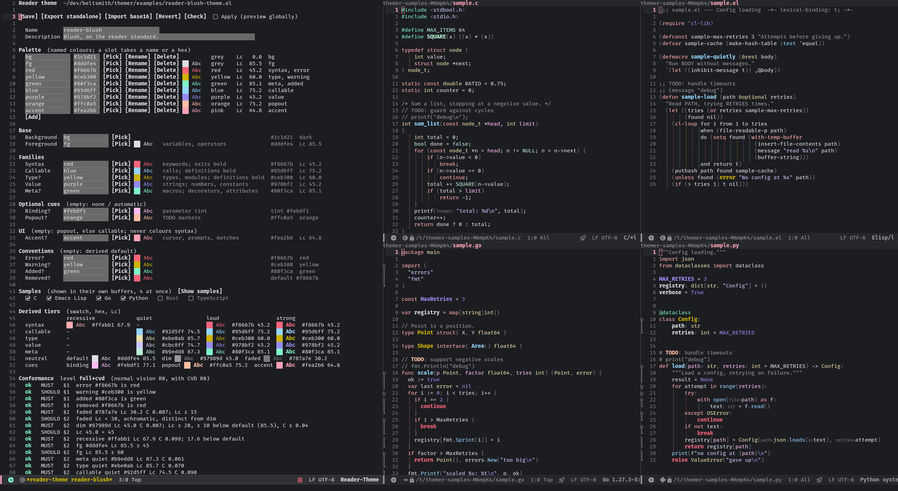

# reader-theme

Emacs colour themes on the **reader** standard for colouring source code
([research/PATTERNS.md](research/PATTERNS.md)), the tools to make and edit
them, and the research behind the standard.

The repository also holds **themer**, the theme-development library
reader-theme is built on: live preview, SVG rendering, an OKLCH colour
picker, code-sample buffers and the colour maths. It doesn't need
reader-theme, and works with any theme, autothemer's included.

## Installation

Both packages come from this repository. With
[straight.el](https://github.com/radian-software/straight.el):

```elisp
(straight-use-package
 '(themer :type git :host github :repo "beltsmith/themer"
          :files ("themer*.el" "samples")))
(straight-use-package
 '(reader-theme :type git :host github :repo "beltsmith/themer"
                :local-repo "themer"
                :files ("reader-theme*.el" "examples")))
(require 'reader-theme)
```

Or with `use-package`:

```elisp
(use-package themer
  :straight (:type git :host github :repo "beltsmith/themer"
             :files ("themer*.el" "samples")))

(use-package reader-theme
  :straight (:type git :host github :repo "beltsmith/themer"
             :local-repo "themer"
             :files ("reader-theme*.el" "examples"))
  :demand t)
```

`:local-repo` makes the two share one clone. themer's `:files` has to
include `samples` for the theme form's code samples, and reader-theme's
`examples` for the example themes (reader-blush, -gruvbox, -monokai,
-kanagawa, -zenburn). For themer alone, install only the first.

Loading `reader-theme` is what puts your theme directory and the examples
on `custom-theme-load-path`, so until then reader themes don't show up in
`load-theme` or `consult-theme`. Either load the package eagerly
(`require` or `:demand t`), or keep it lazy and call
`reader-theme-setup-theme-load-path` before `load-theme`:

```elisp
(use-package reader-theme
  :straight (:type git :host github :repo "beltsmith/themer"
             :local-repo "themer"
             :files ("reader-theme*.el" "examples"))
  :init
  (reader-theme-setup-theme-load-path)
  (load-theme 'reader-blush t))
```

The function is autoloaded; it loads only `reader-theme` (and
`themer-colour`), which the theme needs anyway, and leaves the form and
the themer tools unloaded. Without a generated autoloads file (a plain
`:load-path` checkout), declare it first:
`(autoload 'reader-theme-setup-theme-load-path "reader-theme")`.

## Reader themes

`reader-theme.el` generates themes on the **reader** standard for colouring
source code ([research/PATTERNS.md](research/PATTERNS.md), draft 3.2):
"label quietly, landmark loudly". Hue means the *kind* of token, lightness
and chroma mean importance, and bold marks landmarks. Keywords take a
recessive tint below default ink, calls, types and strings take quiet tints
near default ink, and definitions, exits and literals are loud. Variables
stay in default ink, so the logic stands out.

You choose one accent per kind family. Every tier is derived from it, the
way the reference mapper does it (`research/harness/mapper.py`, mode C).

### Quick start

`M-x reader-theme-new` opens a form for a new theme, empty (seeded
with your current background and foreground) or seeded from a reader theme
you pick by name. `M-x reader-theme-edit` opens the same form on an
existing theme: the current buffer's theme file, or one picked by name from
the reader themes on `custom-theme-load-path` and in
`reader-theme-directory`.

The form has a field for the name and the description, the **palette**
(see [Palettes](#palettes)), and a field for each slot: `:bg`, `:fg`, the
five family accents, the optional parameter tint, popout and UI accent, and
the four conventions. Each slot has:

- an editable field holding a palette name or a raw hex, and a **Pick**
  button (the palette menu, below);
- a swatch: the colour as a block, and as text on the theme's background;
- a short status from the conformance result, for example `fails Lc 35
  (Lc 28.4)`, `quiet tint: not distinct from another quiet tint`,
  `CVD-confusable with callable` or `shed at R2: drawn as callable`.

Below the fields are the derived tiers (recessive, quiet, loud and strong
per family, plus default, dim, faded, the parameter tint and popout, each
with its hex and Lc), and the conformance level with each MUST and SHOULD.



### Samples

The code samples are real buffers, one per language:
`*reader-theme-sample: NAME (LANGUAGE)*`. The form copies each sample file
into a temporary directory of its own and visits the copy, so the buffer
gets the major mode your Emacs uses for the file and runs your hooks as any
file would: rainbow-delimiters, eglot, line numbers, whatever you have on.
`reader-theme-treesit-mode`'s rules are installed as well, at
`treesit-font-lock-level` 4. The derived faces are shown through the
buffer's `face-remapping-alist`, so the theme needn't be enabled. A face
the theme leaves empty is empty here too, and a face the theme doesn't set
keeps your current theme's look, as it would in your editor once the theme
is enabled. Every re-derive updates the remapping in place, keeping point
and scroll. The buffers are read-only (`C-x C-q` to try edits) and are
killed with the form, along with their directory.

The form opens in the selected window, and the samples split off it in a
two-by-two grid: to the right when the window is wide enough for both
(about 260 columns), else below. The samples fill the grid left to right,
then top to bottom, and the grid is laid out afresh whenever the choice of
languages changes. A rule in `display-buffer-alist` overrides the splits.
If you close the windows, the form's **Show samples** button brings them
back.

There are samples for C, Emacs Lisp, Go, Python, Rust and TypeScript, in
[samples/](samples/), each exercising the standard's roles: keywords,
exits, calls, types, function definitions, module-level bindings and
constants, parameters, literals, strings with escapes, comments, a doc
comment, a TODO, commented-out code, and macros, decorators and
attributes. The form's **Samples** section has a checkbox per language;
ticking one shows or hides its buffer at once, without re-deriving. At
most four show at once (`themer-samples-max`): ticking a fifth unticks the
one chosen longest ago. The choice lasts for the session and starts from
`themer-samples-languages` (the first four, by default).

`M-x reader-theme-screenshot` writes a picture of the form and its samples
for a theme you pick, to a `.png`, `.svg` or `.pdf`: it opens the form in a
frame of its own (`themer-render-frame-size`, 264×64 by default), waits for
fontification and eglot, writes the frame and deletes it. From Lisp, pass
the languages to show and the seconds to wait:

```elisp
(reader-theme-screenshot "examples/reader-blush-theme.el" "blush.png"
                         '(c python rust typescript) 5)
```

Eglot semantic tokens come with the real buffers. For each sample whose
mode has an installed server in `eglot-server-programs`, the form connects
eglot in the background, unless your own hooks already did. Eglot paints
the tokens when they arrive, in front of the font-lock and tree-sitter
faces, exactly as in your editor: wherever the theme gives an eglot face a
colour, that colour wins. This is how the theme's eglot faces were found
hiding exits, TODO markers and attributes; see Limitations. The servers
run for the samples' directory only and are shut down with the form. Set
`themer-samples-semantic-tokens` to nil to leave eglot alone (your
hooks may still connect it).

What to expect:

- The sample's mode is whatever visiting the file gives. If your Emacs
  opens `.c` files in `c-mode` rather than `c-ts-mode`, so does the
  sample, and the reader rules (tree-sitter only) don't apply; add a
  `major-mode-remap-alist` entry to change both.
- Only languages whose server you have installed get tokens. rust-analyzer
  treats `sample.rs` as a standalone file, without a `Cargo.toml`.
- Servers differ in what they emit. rust-analyzer sends no `parameter`
  tokens for the Rust sample, for one, so its parameter uses stay plain in
  the sample and in your buffers alike.
- Starting eglot uses its internals `eglot--lookup-mode` and
  `eglot--guess-contact`; see Requirements.

To use your own code, point `themer-samples-directory` at a
directory of files named `sample.EXT`. Every such file there is a sample:
one named like a built-in (`sample.rs`, `sample.py`, ...) replaces it, and
any other extension adds a language.

```elisp
(setq themer-samples-directory "~/.emacs.d/themer-samples/")
;; ~/.emacs.d/themer-samples/sample.rb  -> a Ruby sample
;; ~/.emacs.d/themer-samples/sample.rs  -> replaces the built-in Rust one
```

A sample's mode is the one your Emacs uses for the file, from
`auto-mode-alist` and `major-mode-remap-alist`, and the language is named
after it (`ruby-mode` → Ruby).

### Editing

Edits re-derive after `themer-preview-delay` idle seconds, and only when a
colour changed. Deriving takes about a second; typing during it cancels
and reschedules it. **Apply** enables the theme globally for a live
preview. Turning it off, or killing the form, restores the themes that
were enabled before.

The buttons are **Save**, **Export standalone**, **Import base16** (it
asks which slot each field takes, with defaults from the base16 conventions
and the slots' hue names), **Revert** and **Check** (the full report). TAB
and S-TAB move between fields, `C-c C-c` saves and `C-c C-k` cancels.
`C-c C-a` in a hex field adjusts it with `themer-picker-adjust` (below),
and the form re-derives as the colour changes.

Save writes `:palette` and the slots' references as they are, so a theme
file read and saved unchanged is byte-identical. It writes
`NAME-theme.el` next to the file you edited, or to
`reader-theme-directory` for a new theme. When you edit a file, its
header comment and key order are kept; a renamed theme gets the new name in
its header and footer lines. The file looks like this:

```elisp
(require 'reader-theme)

(reader-theme-deftheme reader-blush
  "Blush, on the reader standard."
  :palette ((bg "#1c1d21")
            (fg "#dddfe4")
            (red "#f8667b")
            (yellow "#ceb300")
            (green "#80f3ca")
            ...)
  :bg bg
  :fg fg
  :syntax red
  :callable blue
  ...)
```

Themes appear in `load-theme` and `consult-theme`: loading `reader-theme`
puts `reader-theme-directory` (without creating it) and, with
`reader-theme-include-examples`, the package's `examples/` on
`custom-theme-load-path`, and Save adds the directory of a theme saved
anywhere. `(load-theme 'reader-blush)` asks you to confirm the theme as
usual; `custom-safe-themes` is not touched.

`examples/reader-blush-theme.el` is the example to start from: a theme
designed on the standard, with nine palette colours, the parameter tint,
popout and UI accent all set, and conformance at `full+cvd`.

The other four are ports, built from the creator assignments
in `research/harness/assignments.yaml`: gruvbox, monokai, kanagawa and
zenburn. Each palette holds the theme's full base16 set under the theme's
own colour names (kanagawa's `sumiInk1`, `fujiWhite`, `oniViolet`…;
zenburn's `red+1`, `yellow-1`…), used or not. `examples/renders/` shows
each of the four on Go, TypeScript and Rust snippets from the research corpus.

### Palettes

A palette defines each colour once, by name. `:palette` is an ordered
list of `(NAME "#rrggbb")` entries, with any symbol as a name (except `t`,
`nil` and keywords). Every slot then takes either a palette name or a hex
string, so themes without a palette still work:

```elisp
(reader-theme-deftheme my-theme "Doc."
  :palette ((ink "#1d1f21") (paper "#c5c8c6") (red "#cc6666"))
  :bg ink :fg paper :syntax red :callable "#81a2be" :value "#b5bd68")
```

Names are resolved before anything is derived (`reader-theme-resolve`),
and an unknown name is an error that names the slot. Derivations are
cached on the resolved colours, so a palette theme and its hex-only twin
share one entry. Editing an entry's hex and re-evaluating (or
`themer-preview-mode`) re-derives every slot that names it. Unused
entries are allowed.

In the form, the **Palette** section comes before the slots. Each entry
has an editable name and hex, a swatch on the theme's background, its hue
name and Lc, and the slots that use it, or "(unused)". Its buttons:

- **Pick**: a new colour with `read-color`;
- **Rename**: renames the entry and every slot that names it. Typing a
  new name into the name field does the same, once the name is usable and
  no other entry has it;
- **Delete**: deletes the entry. If slots use it, it asks first, and those
  slots then take its hex.

**Add**, under the entries, reads a colour and a name (default: its hue
name). Editing an entry's hex live-updates every slot that names it, the
tiers, the samples and the conformance checks.

A slot's **Pick** opens a menu of the palette entries, each annotated with
a swatch, its hex and its hue, plus **Custom hex…** (`read-color`; the slot
gets a raw hex) and **Add to palette…** (a hex and a name; the slot then
names the new entry). You can also type a name or a hex in the field.

**Import base16** fills the palette with the scheme's slots, `base00` to
`base0F` (or `base17` for base24), and asks which slot each field names:
`:bg` `base00`, `:fg` `base05`, and the families from the base16
conventions. Earlier entries that other fields still use are kept. A new
theme with no seed starts with a palette of the current `bg` and `fg`.

### Spec keys

Every colour key takes a palette name or a `"#rrggbb"` string.

| Key | | Used for |
|---|---|---|
| `:palette` | optional | `((NAME "#rrggbb") ...)`: named colours for the other keys |
| `:bg`, `:fg` | required | background, default ink (variables, parameters, fields, operators) |
| `:syntax` | required | keywords (recessive), exits: `return`, `raise`/`throw`, `break`, `continue`, `yield`, `goto`, Rust `?` (bold) |
| `:callable` | required | calls and builtins (quiet), function definitions (bold) |
| `:value` | required | strings (quiet), numbers, constants and escapes (loud) |
| `:type` | optional | type uses and modules (quiet), type definitions (bold) |
| `:meta` | optional | macro calls (quiet), decorators, attributes and preprocessor (loud) |
| `:binding` | optional | a quiet parameter tint. It never appears loud, so it isn't a sixth family |
| `:popout` | optional | TODO/FIXME/XXX ink. By default, the first fixed colour whose hue no family uses |
| `:accent` | optional | the UI accent (below). By default `:popout`, else the callable family's loud colour |
| `:error`, `:warning`, `:added`, `:removed` | optional | diagnostics and diffs. Defaults are a red, a yellow and a green for the background |

UI faces (region, `hl-line`, mode line, completion, diff and diagnostics)
come from OKLab mixes of `:bg` and `:fg` and the fixed colours.
Diagnostics are wavy underlines in the error and warning colours.
End-of-line diagnostics (`flymake-*-echo-at-eol`) are smaller, in dim or
diagnostic ink, and italic only with `reader-theme-italic-comments`.

The standard's conventions carry into other packages:

- **Diffs.** `magit` and `diff-hl` use the same green and red backgrounds
  as `diff-mode`. Magit's current hunk gets `diff-added`'s mix, and the
  other hunks a lighter one.
- **Org.** `org-todo` is the popout colour, as TODO is in code comments.
  `org-done` uses the added colour. Metadata (meta lines, drawers,
  keywords, tags, block delimiters) is dim, like comments. Blocks and
  quotes get a subtle background. `org-code` is a loud value and
  `org-verbatim` a string. Heading level 1 is the accent. Levels 2–8
  (`outline-2`…`outline-8`, which org's levels inherit) step through the
  families' loud colours.
- **Completion.** `marginalia` draws function names in the call colour
  and types in the type colour, as code does.
- **Editor state.** `dired` flags are error-coloured and marks
  warning-coloured. Ignored files are dim. Unmatched rainbow delimiters
  are errors. Deprecated `corfu` candidates are struck through.
- **Terminal colours.** The 16 `ansi-color-*` faces (term and vterm
  inherit them) must look like their names, whatever hues the families
  use. Each takes the first match from: the error, added or warning colour
  (for red, green, yellow), then the families' loud colours, choosing one
  with the right hue name and Lc ≥ 35. Failing that, the colour is made at
  the loud colours' mean lightness and chroma. Bright forms are 0.08
  lighter (darker on a light background). Black, white and their bright
  forms come from the neutral tiers.

Syntax hue isn't spent on things with no kind behind them: rainbow
delimiter depths, `avy` and `ace-window` hints, and evil-state or magit
branch colours keep their packages' defaults.

### UI accent

`:accent` is one colour for the chrome, never for syntax, so it doesn't
count as a family. It draws the cursor, minibuffer and shell prompts, the
current line number, key bindings (`help-key-binding`, `which-key`,
`embark`, `marginalia`), the buffer name and LSP status in the mode line,
the mode-line highlight box, `isearch` (the accent as background, bold,
in `:bg`-coloured text), the matching paren, completion matches
(`completions-common-part`, `orderless` group 0, `consult`), diff hunk
headers, and headings in `magit`, `org`, `outline`, `dired` and the
agenda. Two conformance lines check it (SHOULDs): Lc ≥ 60 on the
background, and Lc ≥ 60 for the `isearch` text on the accent. In the form
it is the **Accent** field under **UI**, with Pick, a swatch and a status.
The examples each set one, with the reason in a comment.

### Conformance

`M-x reader-theme-check` shows the report for the theme in the current
buffer, or for the enabled reader theme. It lists the derived tiers and
each MUST and SHOULD of PATTERNS.md §1–§4, and gives the level reached:

| Level | Meaning |
|---|---|
| `full+cvd` | every MUST, plus the loud accents stay reliably distinct under deutan and protan simulation |
| `full` | every MUST under normal vision |
| `R1` | meta is shed: its roles use the syntax family |
| `R2` | type is shed too: types use the callable family |
| `R3` | R2, with the quiet cues that fail set to default ink |
| `R4` | R3, with keywords in default ink as well |
| `none` | the loud families still fail at R2 |

The level is reached under normal vision, because the standard makes the CVD
rules SHOULDs. The faces follow that level. reader-blush reaches
`full+cvd`. The ported examples reach R2 (gruvbox, zenburn), R3 (monokai)
and R1 (kanagawa), and none meets the CVD SHOULDs; these match the
reference mapper.

`M-x reader-theme-export` writes a standalone `deftheme` with the colours
baked in and no dependency on reader-theme or themer. If the theme has a palette, the
entries the faces use are bound in a `let` and the faces name them
(`` `(default ((t :foreground ,fg :background ,bg))) ``), so the export
stays readable. With a prefix argument it adds a note
about the faces that need the rules mode.

### Generating a theme

`research/harness/generate.py` writes the most readable theme for a
background, a foreground and a hue name per family. Write the spec as
`Key value` lines:

```
Background  #1c1d21
Foreground  #dddfe4
Syntax      red
Callable    blue
Type?       yellow
Value       purple
Meta?       green
```

```sh
cd research
uv run --with coloraide --with pyyaml --with numpy --with scipy \
  python harness/generate.py spec.txt --name my-theme   # -> my-theme-theme.el, ~20 s
```

A family can be a hue name (`red orange yellow green cyan blue purple pink`)
or a hex, which is kept as given. A trailing `?` makes type or meta
optional: if it can't conform, the theme is generated without it and
reported at the level §4 gives (R1 without meta, R2 without type). You can
also pass `popout=` and `binding=` (`binding=none` for no parameter tint).
The spec can be given as `key=value` arguments instead.

The script searches each family's hue within its name's range, then the
lightness and chroma of its loud form. Every candidate is scored by the
reference mapper (`map_reader`, mode C), in this order: the level, then
the fewest MUST failures, then the fewest failures under CVD simulation,
then the loud SHOULDs (Lc ≥ 45, distinct from its own quiet form), then
the least distinct pair of cues. The TODO marker (also the UI accent) and
the parameter tint get hues no family uses. The file it writes is an
ordinary `reader-theme-deftheme`, and `reader-theme-check` derives the
same tiers from it. The search and the score are documented in the script.

### Tree-sitter rules

Emacs's tree-sitter modes don't separate exits from other keywords, or type
definitions from type uses. `reader-theme-treesit-mode` is a global minor
mode that adds `:override` font-lock rules to the tree-sitter modes for
python, javascript, typescript, tsx, rust, go, c, c++, java, lua and bash,
when the grammar is installed. The rules cover:

- exits (`reader-theme-exit`), including Rust's `?`;
- type definition names (`reader-theme-type-definition`);
- decorators, attributes and annotations (`reader-theme-meta`), and macro
  calls and definitions;
- parameter declarations (`reader-theme-parameter`);
- module-level variable bindings, bold default ink
  (`reader-theme-module-variable`), and constant definitions, strong in
  the value family (`reader-theme-constant-definition`). Locals keep the
  plain variable face;
- TODO, FIXME and XXX in comments (`reader-theme-todo`);
- commented-out code, drawn faded (`reader-theme-commented-code`). This
  one is only on when `reader-theme-fade-commented-code` is set. Detection
  is the harness's heuristic (`role_tokens.py`), about 88% precise on
  corpus samples.

"Top level" means not inside a function, method, lambda or closure, as in
the research corpus (`role_tokens.py`). Class bodies, namespaces and
top-level blocks count as top level. Which declarations count:

| Language | Module variable (top level only) | Constant definition |
|---|---|---|
| Python | assignment targets, including class bodies | ALL_CAPS targets at top level |
| JavaScript, TypeScript, TSX | `let`/`var` declarators, and `const` ones not named ALL_CAPS | top-level `const` named ALL_CAPS |
| Rust | `static mut` items | `const` items and non-`mut` `static` items, at any scope |
| Go | `var` specs | `const` specs, at any scope |
| C, C++ | file- and namespace-scope declarators (not prototypes) | top-level `const`/`constexpr` declarations (not a pointer to const); object-like `#define` with a value |
| Java | none: fields stay fields | `static final` fields, interface constants |
| Lua | `local` and global assignments | `local NAME <const>` (or `<close>`) at top level |
| Bash | assignments, `export`, `declare` | `readonly` or `declare -r` at top level |

ALL_CAPS is the research's test, `_?[A-Z][A-Z0-9_]+`. Most top-level
`const` in JavaScript and TypeScript are ordinary bindings (94% of
TypeScript locals are `const`), so only ALL_CAPS names count as constants.
A JS/TS declarator whose value is a function (`const f = () => ...`) is drawn
as a function definition. A `#define` with no value (include guards, feature
flags) stays a macro definition.

Loading a reader theme turns the mode on, unless
`reader-theme-enable-rules` is nil. A rule group whose query doesn't
compile against the installed grammar is skipped with a message.

### Limitations

- Module-level bindings and constant definitions need
  `reader-theme-treesit-mode` and a tree-sitter mode. Without it,
  `font-lock-variable-name-face` is plain default ink everywhere.
- C++ `static constexpr` class members and Java `final` instance fields
  are fields, so they aren't drawn as constant definitions.
- The tree-sitter rules only mark parameter *declarations*. Parameter uses
  get the binding tint only from eglot semantic tokens
  (`eglot-semantic-parameter`).
- Eglot puts its semantic-token faces in front of tree-sitter's, so only
  what tree-sitter can't know is coloured: parameter uses, enum members,
  macro uses, decorators, namespaces and deprecation. The rest (keywords,
  comments, strings, ...) are left empty so exits, TODO markers, escapes
  and bold definitions show through. Rust-analyzer also calls primitives
  (`u32`) and `derive` namespaces; `reader-theme-treesit-mode` drops the
  namespace face wherever tree-sitter drew a type or an attribute.
- On muted palettes the quiet tints sit close to default ink, as the
  standard intends, and can be hard to see. Kanagawa's call tint is one
  example. Low-chroma palettes such as zenburn struggle most.
- Deriving a theme takes about a second. Results are cached per spec, so
  re-enabling an unchanged theme, or going back to an earlier colour in
  the form, is instant.

## themer

The library under reader-theme, usable on its own. `(require 'themer)`
loads all of it; each file can also be required alone.

### `themer-samples-show`

Code samples in real buffers, one per language, showing a set of faces
through `face-remapping-alist` without enabling a theme. The reader theme
form uses them; see [Samples](#samples) for how they behave and how to add
your own.

### `themer-preview-mode`

Turn it on in a `<name>-theme.el` buffer. After each edit, saved or not, it
re-evaluates the buffer and re-enables the theme (after
`themer-preview-delay`, 0.4s idle by default), so changes to a palette hex
or a role binding show up in every window straight away.

For [autothemer](https://github.com/jasonm23/autothemer) themes, it also
paints each palette and role name with the colour it resolves to, both
where it's defined and wherever a face spec uses it, so you can read the
role → colour mapping straight off the buffer.
Other theme macros can register in `themer-preview-forms`: a macro and a
function returning its form's palette. In such a form the mode paints each
hex string and each palette name, where it's defined and where it's used.
reader-theme registers `reader-theme-deftheme` this way.

- Unbalanced parens mid-edit are skipped.
- If evaluation fails, the previous face settings are restored.
- Turning the mode off removes the swatches. It also disables the theme
  if the theme wasn't already enabled when you turned the mode on.

### `themer-render`, `themer-render-compare`

Render the faces Emacs actually resolved in a buffer (font-lock,
tree-sitter, eglot semantic tokens, all of it) to an SVG. The colours come
from the live face pipeline, not a hand-tagged sample, so the image shows
exactly what the theme does to real code, including the places where one
layer overrides another.

- `themer-render` renders the region, or the visible window if no region
  is active.
- `themer-render-compare` renders font-lock alone next to font-lock plus
  eglot semantic tokens, and underlines every character whose look the
  tokens changed. Use it to spot a semantic-token face clobbering a more
  specific tree-sitter face.

The image opens in `*themer-render*`; press `w` there to write the SVG.

#### Headless

```sh
emacs --batch -L path/to/themer -l themer -l setup.el \
      -f themer-batch-render FILE OUT.svg [SETTLE-SECONDS] [LINES]
```

`setup.el` loads the theme and sets whatever the render depends on:
`treesit-font-lock-level`, the major mode for `FILE`, and
`eglot-server-programs`. If a server is configured for `FILE`'s mode, batch
mode starts eglot itself, waits `SETTLE-SECONDS` (default 3) for the server
to index, and renders the comparison. Otherwise it renders font-lock alone.
Slow-indexing servers such as rust-analyzer need around 20–25 seconds.
`LINES` (for example `301-332`) renders only that range. The whole file is
still parsed, so tree-sitter sees the full context.

To get a PNG: `rsvg-convert OUT.svg -o OUT.png`.

### `themer-render-frame`, `themer-render-frame-with`

Write a frame as Emacs drew it, to a `.png`, `.svg` or `.pdf`, for
pictures to use elsewhere. Needs an Emacs built with Cairo.

- `themer-render-frame` writes the selected frame.
- `themer-render-frame-with FILE SETUP` makes a frame
  `themer-render-frame-size` large, calls `SETUP` in it, waits for things to
  settle, writes the frame, and deletes it, killing the buffer `SETUP`
  returns. A tiling window manager may resize the frame first.

### `themer-picker-adjust`

`M-x themer-picker-adjust` picks up the `#rrggbb` (or `#rgb`) at point, or
the one in the region, in any buffer, and adjusts it in place. The text and
a swatch over it update with each key:

| Key | |
|---|---|
| `l` / `L` | OKLCH lightness down / up |
| `c` / `C` | chroma down / up |
| `h` / `H` | hue down / up |
| `r` | read a new colour (`read-color`) |
| `RET` | accept |
| `C-g`, `q` | revert |

A prefix argument multiplies the step (`C-u l`, `5 H`), and any other key
accepts and then runs as usual. The colour is held in OKLCH, so its hue
survives a trip through grey; out-of-gamut values are fitted to sRGB, and
the echo area shows the chroma you actually got. An upper-case hex stays
upper-case. The whole adjustment is one undo step. In a
`themer-preview-mode` buffer the theme reloads as you adjust.

## Options

| Option | Default | |
|---|---|---|
| `themer-preview-delay` | `0.4` | Idle seconds before re-evaluating, or before the form re-derives |
| `themer-render-font-family` | `nil` | `nil` uses the `default` face's family |
| `themer-render-font-size` | `14` | Pixels |
| `themer-render-char-width` | `0.6` | Column width as a fraction of the font size |
| `themer-render-line-height` | `1.45` | Multiple of the font size |
| `themer-render-semtok-timeout` | `10` | Seconds to wait for semantic tokens |
| `themer-render-diff-colour` | `nil` | `nil` uses the `shadow` face |
| `themer-render-frame-size` | `(264 . 64)` | Columns and lines of the frame `themer-render-frame-with` makes |
| `reader-theme-directory` | `themes/` in `user-emacs-directory` | Where new themes are saved, and searched by `reader-theme-edit`. Put on `custom-theme-load-path` |
| `reader-theme-include-examples` | `t` | Put the package's `examples/` on `custom-theme-load-path` |
| `reader-theme-enable-rules` | `t` | Loading a reader theme turns on `reader-theme-treesit-mode` |
| `themer-samples-directory` | `nil` | Your own `sample.EXT` files; each is a sample, and replaces a built-in of the same name |
| `themer-samples-languages` | `t` (the first four) | Languages whose samples the form shows at first, at most four |
| `themer-samples-semantic-tokens` | `t` | Connect eglot in the sample buffers |
| `reader-theme-fade-commented-code` | `nil` | Draw code-like comments in the faded tier |
| `reader-theme-italic-comments` | `nil` | Italic comments |
| `themer-picker-steps` | `(0.01 0.005 2.0)` | `themer-picker-adjust` steps: OKLCH lightness, chroma, hue in degrees |

## Requirements

Emacs 29.1+. The reader rules need the tree-sitter grammars for the
languages you use. The semantic-token comparison (`themer-render-compare`)
needs the eglot that ships with Emacs 31: it reads eglot's internal
`eglot--semtok-state` to tell when tokens have arrived. The theme form
starts eglot in its samples through `eglot--lookup-mode` and
`eglot--guess-contact`; if a later eglot changes these, the samples simply
go without a server the form would have started.
